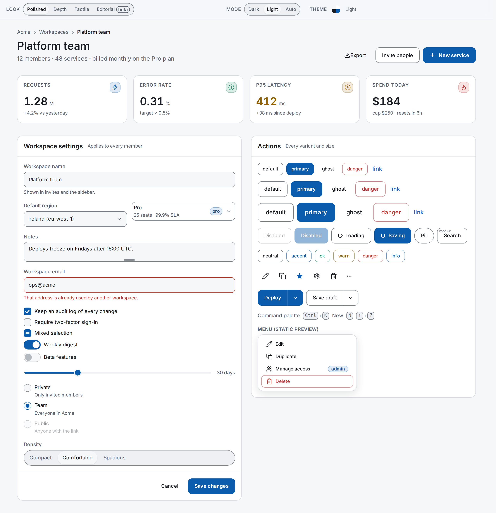

# @dorsk/tsumikit

Svelte 5 UI components styled with plain CSS variables: 31 themes, WCAG AA contrast, no runtime dependencies.

[](https://www.npmjs.com/package/@dorsk/tsumikit)
[](https://github.com/DorskFR/tsumikit/actions/workflows/ci.yml)
[](https://svelte.dev)
[](LICENSE)

<picture>
  <source media="(prefers-color-scheme: dark)" srcset="docs/assets/hero-dark.png">
  
</picture>

^ The [`/looks`](https://dorskfr.github.io/tsumikit/looks) showcase page in the `light` and `dark` themes, regenerated with `npm run readme:shots`.

tsumikit is a component kit for Svelte 5 apps that want a consistent, themeable UI without Tailwind, a CSS-in-JS runtime or a CDN. Every colour, space, radius and size is a CSS custom property, so a theme is one block of variables and a component is restyled from outside with `style="--btn-bg: …"`. It ships a design lint and a set of [design principles](principles/README.md) that keep apps built on it consistent. Interactive pieces use the platform (`<dialog>`, the Popover API, native form controls) instead of JavaScript reimplementations.

[Live demo with every component and prop](https://dorskfr.github.io/tsumikit)

## Install

```sh
npm i @dorsk/tsumikit
```

Requires Svelte 5 (`svelte@^5.0.0` peer). No other runtime dependencies; the Inter font is bundled.

## Quick start

Import the stylesheet once at the app root, then use the components:

```svelte
<script lang="ts">
  import '@dorsk/tsumikit/styles/app.css';
  import { Button, Field, Input, Toaster, toasts } from '@dorsk/tsumikit';

  let name = $state('');
</script>

<Field label="Workspace name" for="name">
  <Input id="name" bind:value={name} />
</Field>
<Button variant="primary" onclick={() => toasts.ok(`Saved ${name}`)}>Save</Button>
<Toaster />
```

Run `npm run dev`, type a name and press Save: an `ok` toast appears in the corner.

### Start a new project

Copy [`examples/starter`](examples/starter) and change `"@dorsk/tsumikit": "file:../.."` to a version. It is the baseline every app should start from: the kit stylesheet (tokens, themes, Inter), `AppShell`, a `ThemePicker`, a `Toaster`, an `+error.svelte` that says what happened in plain words (404 included), a list page with URL-driven filters (`Tabs href` + `urlState`), `LoadMore`, empty and filtered-empty states, delete with `toasts.undo()` instead of a confirm dialog, and `tsumikit-lint` on every commit via lefthook.

Upgrading from 0.81 or older: [docs/MIGRATION-0.82.md](docs/MIGRATION-0.82.md) lists what looks different and how to revert each change.

## Theming

31 themes ship, from `light` and `dark` to `nord`, `dracula`, `solarized` and a colour-blind-safe `colorblind` (Okabe-Ito). The test suite fails if any of them drops below WCAG AA contrast. Add `<ThemePicker />` to let users switch; the choice persists in `localStorage` and follows `prefers-color-scheme` in `auto` mode.

Register your own theme without copying kit files:

```ts
import { theme } from '@dorsk/tsumikit';
theme.register({ id: 'acme', label: 'Acme', mode: 'dark' });
theme.setDefault('acme');
```

```css
/* brand.css, imported after the kit stylesheet */
[data-theme='acme'] {
  --c-bg: #2a2a2a;
  --c-accent: #5ac8c8;
  /* …the rest of the 19 --c-* palette tokens, shadows and --mach-* pairs */
}
```

Restyle one component through its published custom properties:

```svelte
<Button style="--btn-bg: var(--c-violet); --btn-fg: #fff; --btn-radius: 0">Ship</Button>
```

Optional looks (`depth`, `tactile`, `editorial`) change shape and elevation on top of any theme: import `@dorsk/tsumikit/looks/depth.css` and call `theme.setLook('depth')` or render `<LookPicker />`.

Full contract, per-file stylesheet imports and the typeface: [docs/theming.md](docs/theming.md). Every component's custom properties and how to attach test ids: [docs/styling.md](docs/styling.md).

## Components

Each layer reaches only one layer down: `tokens.css` holds every value, atoms are the only place raw `<button>`/`<input>`/`<select>` live, molecules compose atoms, layouts arrange them. Props, including `aria-*`, spread down onto the underlying element. The layer rules: [docs/design.md](docs/design.md).

- [Atoms](docs/components.md#atoms): Text, Heading, Button, Input, Textarea, Select, Switch, Checkbox, Slider, Gauge, Avatar, Card, Badge, Link, Icon
- [Molecules](docs/components.md#molecules): Field, Modal, Popover, Menu, Tabs, Combobox, Disclosure, Accordion, Toaster, ThemePicker, Drawer, SplitButton, SortableList
- [Organisms](docs/components.md#organisms): DataTable, ConversationPanel, ConversationFeed, FilterSearchBar
- [Layouts](docs/components.md#layouts): AppShell, NavBar, MasterDetail, Container, Stack, Cluster, AutoGrid
- [Mobile and media](docs/components.md#mobile-tabbar-swiperow-pulltorefresh): TabBar, SwipeRow, PullToRefresh, SeekSlider, VolumeSlider
- [Stores and helpers](docs/components.md#stores-actions-and-helpers): `theme`, `toasts`, `fontScale`, `autoresize`, `copyToClipboard`

Guides:

- [Patterns](docs/patterns.md): calm loading, undo over confirm, state in the URL, masked spans while typing, breakpoints
- [Layout, sizing and touch targets](docs/layout.md): container queries, rem sizing and zoom, toolbar control heights, 44px hit areas
- [Guardrails](docs/guardrails.md): the `tsumikit-lint` CLI and dev-mode design warnings
- [Sound](docs/sound.md): opt-in UI sound effects, off by default
- [Accessibility and platform features](docs/accessibility.md)
- [Design principles](principles/README.md): 30 principles with a check for each, shipped in the package

## Limitations

- Svelte 5 only. There is no Svelte 4 or framework-agnostic build.
- No syntax highlighter is bundled. `CodeBlock` takes a `highlight` callback; highlight.js and Prism classes are mapped to the theme tokens ([details](docs/components.md#syntax-highlighting-codeblock)).
- Internal class names (`.btn`, `.select-wrap`) and `data-tsu` markers are private and change without a major bump. Style through the published custom properties, not `:global()`.
- The kit is pre-1.0 and minor releases can change defaults. Migration notes for 0.80 and 0.82 are in [`docs/`](docs/).

## Development

```sh
git clone https://github.com/DorskFR/tsumikit && cd tsumikit
npm install
npm run dev          # showcase at the printed URL (+ /shell for the AppShell demo)
npm test             # contract tests (node --test)
npm run lint         # biome
npm run check        # svelte-check
npm run build        # prerendered static site in /build
npm run package      # publishable library in /dist (+ publint)
npm run readme:shots # regenerate docs/assets/hero-*.png (needs npm run dev -- --port 5391)
```

Git hooks (Biome on commit, `svelte-check` on push) are installed by lefthook through the `prepare` script. Releases are published to npm from a `v*` tag by GitHub Actions with trusted publishing, so no npm token is stored.

## License

[MIT](LICENSE)
